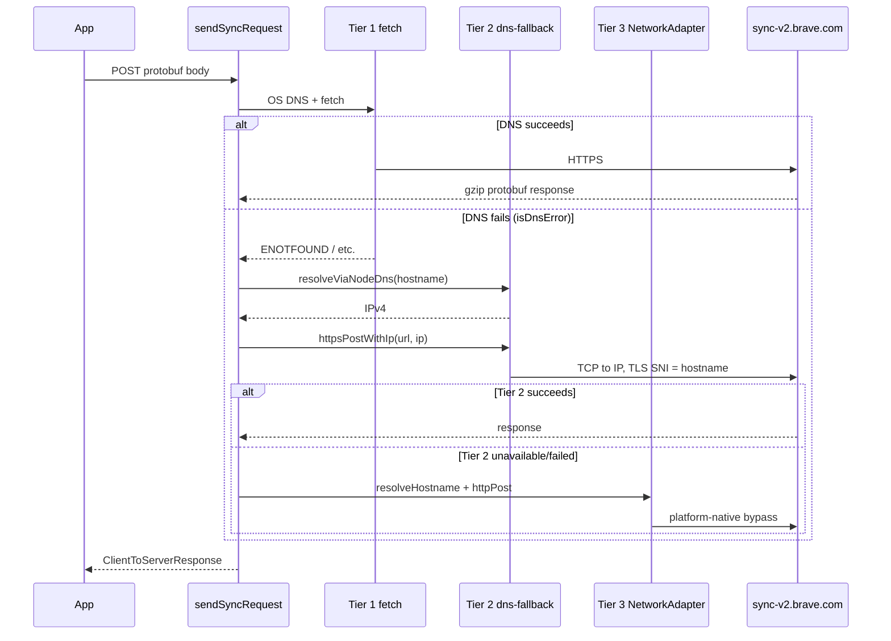

# DNS Fallback for Brave Sync Connectivity

## Overview

`brave-sync-ts` talks to Brave’s sync server at `https://sync-v2.brave.com/v2/command/`. In some networks—especially where an ISP or corporate firewall **blocks or poisons DNS** for that hostname—the library would fail with resolution errors (`ENOTFOUND`, `EAI_AGAIN`, etc.) even though the Brave browser on the same machine could still sync.

This document explains **why that happens**, **what we built to fix it**, and **how the tiered fallback strategy works** across Node.js, React Native, and other runtimes.

---

## 1. The Problem

### Symptom

Sync operations (`readPasswords`, `pushPassword`, `commitEntities`, etc.) fail at the HTTP layer with errors such as:

```
TypeError: fetch failed
  cause: Error: getaddrinfo ENOTFOUND sync-v2.brave.com
```

Or, on React Native (Hermes), a generic:

```
Network request failed
```

The failure occurs **before** any TLS handshake or Brave API logic runs—the client never reaches the server.

### Root cause: OS DNS vs Brave browser DNS

| Environment | DNS resolver used | Behavior when ISP blocks `sync-v2.brave.com` |
|-------------|-------------------|------------------------------------------------|
| **Brave browser** | Chromium’s built-in DNS (DoH / secure DNS, bypasses OS) | Often still works |
| **Node.js `fetch()`** | OS / system resolver (`getaddrinfo`) | Fails with DNS errors |
| **React Native** | Platform network stack (OS resolver) | Fails; no POSIX error codes exposed |

Brave intentionally routes sync traffic through its own resolver stack. **Node.js and mobile runtimes do not.** They delegate to whatever DNS the OS or network provides. If that resolver returns NXDOMAIN, a sinkhole IP, or times out for `sync-v2.brave.com`, every `fetch()` to the sync URL fails.

This is a **connectivity** problem, not a crypto, auth, or protobuf issue. Changing the seed phrase or service key does not help.

### Why a naive fix is insufficient

- **Changing system DNS** (e.g. to 8.8.8.8) works but is outside the library’s control and may not be possible on locked-down devices.
- **Hard-coding the server IP** breaks when Brave rotates infrastructure and breaks **TLS**: certificates are issued for `sync-v2.brave.com`, so the client must still present that hostname in **SNI** and validate the cert against it.
- **Proxying through a third party** adds operational cost and trust assumptions we wanted to avoid for a self-contained library.

We needed a approach that mirrors what Brave already does: **resolve via a trustworthy public DNS path, then connect to the correct IP while keeping the original hostname for TLS.**

---

## 2. Solution Strategy

### Design goals

1. **Transparent retry** — Callers keep using the same APIs; fallback runs inside `sendSyncRequest()` when a DNS failure is detected.
2. **Happy path unchanged** — Normal `fetch()` via OS DNS is always Tier 1; no extra latency when DNS works.
3. **Correct TLS** — TCP connects to a resolved IP, but TLS SNI and certificate validation use `sync-v2.brave.com`.
4. **Runtime-appropriate** — Node.js uses built-in `dns` + `https` modules; React Native and browsers use an optional pluggable adapter.
5. **Fail clearly** — If all tiers exhaust, throw an actionable error (ISP block, suggest public DNS or VPN).

### Tiered fallback chain

All sync HTTP traffic flows through `sendSyncRequest()` in `src/sync/client.ts`. On failure, the client walks this chain:

```
┌─────────────────────────────────────────────────────────────────┐
│  Tier 1 — fetch() + OS DNS                                      │
│  Default path; works when system DNS resolves the hostname      │
└────────────────────────────┬────────────────────────────────────┘
                             │ DNS error (isDnsError)
                             ▼
┌─────────────────────────────────────────────────────────────────┐
│  Tier 2 — Node.js only (src/sync/dns-fallback.ts)               │
│  1. resolveViaNodeDns() → query 8.8.8.8 / 1.1.1.1 / 8.8.4.4     │
│  2. httpsPostWithIp()   → connect to IP, SNI = original host    │
└────────────────────────────┬────────────────────────────────────┘
                             │ unavailable or failed
                             ▼
┌─────────────────────────────────────────────────────────────────┐
│  Tier 3 — NetworkAdapter (optional, src/sync/adapter.ts)        │
│  Platform-native resolve + HTTPS (e.g. React Native native mod) │
└────────────────────────────┬────────────────────────────────────┘
                             │ still failed
                             ▼
                    Actionable error to caller
```

#### Tier 1: Standard `fetch()`

- Uses the runtime’s normal HTTP stack and OS DNS.
- Identical to pre-fallback behavior; zero overhead when connectivity is fine.

#### Tier 2: Node.js public DNS + custom connect

Implemented in `src/sync/dns-fallback.ts`:

1. **`resolveViaNodeDns(hostname)`**  
   - Only runs when `detectRuntime() === "node"`.  
   - Creates a `dns.Resolver` pointed at public resolvers (`8.8.8.8`, `1.1.1.1`, `8.8.4.4`) and calls `resolve4()`.  
   - Bypasses the OS resolver entirely for this lookup.  
   - Caches hostname → IPv4 in-process for the lifetime of the process.

2. **`httpsPostWithIp(url, headers, body, ip)`**  
   - Uses Node’s `https.request` with a custom **`lookup`** callback that returns the pre-resolved IP.  
   - Request options still set `hostname: url.hostname` so **TLS SNI** and certificate validation use `sync-v2.brave.com`.  
   - Equivalent to `curl --connect-to sync-v2.brave.com:443:IP:443`.  
   - Handles Node.js v24’s changed `lookup` callback shape (`opts.all`).

3. **`isDnsError(err)`**  
   - Detects `EAI_AGAIN`, `EAI_NONAME`, `ENOTFOUND` in the error message, `err.cause`, or `errno` code.  
   - Ensures non-DNS failures (HTTP 4xx/5xx, TLS errors, timeouts) are **not** retried through the fallback chain.

#### Tier 3: Pluggable `NetworkAdapter`

Node’s `dns` and `https` modules are not available in React Native or the browser. For those environments, consumers can pass a **`NetworkAdapter`** via `SyncClientOptions.networkAdapter` (and through public APIs like `PushPasswordOptions.networkAdapter`).

The interface (`src/sync/adapter.ts`) requires two capabilities:

| Method | Responsibility |
|--------|----------------|
| `resolveHostname(hostname)` | Query public DNS via platform APIs (e.g. raw UDP to 8.8.8.8 from Kotlin/Swift) |
| `httpPost(url, headers, body, resolvedIp)` | HTTPS POST to the IP with correct **Host** header and **SNI** for `url.hostname` |

Example companion package: `@zenten/rn-brave-sync-adapter` with `createRnNetworkAdapter()`.

React Native’s Hermes engine reports `"Network request failed"` for many failures; `isDnsError()` treats that as eligible for Tier 3 so the adapter can run.

---

## 3. Request Flow (Detailed)



After any successful tier, the response body is gunzipped (if needed) and parsed as `ClientToServerResponse` protobuf—same as Tier 1.

---

## 4. Integration Points

### Where fallback is wired

| Module | Role |
|--------|------|
| `src/sync/client.ts` | `sendSyncRequest()` orchestrates all three tiers |
| `src/sync/dns-fallback.ts` | Tier 2 helpers + runtime detection + DNS error classification |
| `src/sync/adapter.ts` | `NetworkAdapter` interface for Tier 3 |
| `src/index.ts` | Passes `networkAdapter` from `readPasswords`, `pushPassword`, etc. into `SyncClientOptions` |
| `src/types.ts` | `PushPasswordOptions.networkAdapter` |

### Public API usage (React Native)

```typescript
import { readPasswords } from "brave-sync-ts";
import { createRnNetworkAdapter } from "@zenten/rn-brave-sync-adapter";

const networkAdapter = createRnNetworkAdapter();

const passwords = await readPasswords({
  seedPhrase: "...",
  networkAdapter,
});
```

Node.js CLI and scripts get Tier 2 automatically—no adapter required.

---

## 5. Operational Notes

### When fallback will not help

- **IP-level blocking** — If the network blocks traffic to Brave’s sync IPs (not just DNS), public DNS resolution succeeds but TCP/TLS still fails. Users need a VPN or different network.
- **Deep TLS interception** — Corporate MITM proxies that break certificate validation are a separate class of problem.
- **Browser-only web apps** — Tier 2 is Node-only; browsers cannot open arbitrary DNS sockets. Tier 3 would require a browser extension or server-side proxy, which is out of scope for this library.

### User-facing error when all tiers fail

```
DNS resolution failed for sync-v2.brave.com via OS DNS and public DNS (8.8.8.8).
Your ISP appears to be blocking sync-v2.brave.com at the DNS level.
Fix: change your system DNS to 1.1.1.1 or 8.8.8.8, or use a VPN.
```

### Security considerations

- Querying Google (8.8.8.8) or Cloudflare (1.1.1.1) DNS reveals the lookup to those operators—same tradeoff as using DoH in a browser.
- Connecting by IP with correct SNI does **not** disable certificate verification; Node’s `https` still validates the cert for `sync-v2.brave.com`.
- The in-memory DNS cache only stores hostname → IP; it does not cache credentials or sync payloads.

---

## 6. Summary

| Question | Answer |
|----------|--------|
| **What was broken?** | Sync failed when OS DNS could not resolve `sync-v2.brave.com`, while Brave browser often still worked. |
| **Why?** | Node/RN use the system resolver; Brave uses its own DNS stack. |
| **What did we build?** | Automatic tiered fallback inside `sendSyncRequest()`: OS `fetch` → Node public DNS + IP connect with SNI → optional `NetworkAdapter`. |
| **Key technique** | Resolve via public DNS, connect to the returned IP, preserve original hostname for TLS (SNI + cert check). |
| **Who needs to configure anything?** | Node users: nothing. React Native: supply `networkAdapter`. End users on blocked networks: may still need system DNS change or VPN if all tiers fail. |

This brings `brave-sync-ts` closer to Brave browser’s resilience on hostile or filtered networks, without requiring callers to change their sync logic beyond an optional adapter on mobile.
